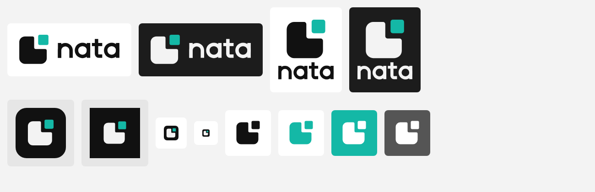

# NATA brand: logo and usage

**Idea:** a tile with one corner open and a teal piece about to drop into it. *Nata* comes from *menata*,
"to put in order": every photo finds its place.

**Wordmark:** lowercase "nata", custom geometric letters built as outlines (no font file, no licence needed).
The single-storey a, round arches and curved t-foot echo the tile's soft corners.

**Why it replaced the split-tile mark:** the old mark (a rounded square cut on a 60° diagonal) was meant to read as
"two piles", but it looked like a generic split app tile. It said nothing about the name, and on the app icon it
became a square inside a square. The new mark keeps the tile and the teal, so the equity carries over, and gives
them one readable idea.

## Files

| Asset | Files | Use |
| --- | --- | --- |
| Symbol | `svg/nata-symbol-{color,reversed,black,white,teal}.svg` | App UI, avatars, small spaces |
| Horizontal lockup | `svg/nata-horizontal-*.svg` | Default: headers, README, docs |
| Stacked lockup | `svg/nata-stacked-*.svg` | Square spaces: splash, social, posters |
| Wordmark only | `svg/nata-wordmark-{black,reversed,white,teal}.svg` | Only when the symbol is already nearby |
| App icon | `svg/nata-app-icon.svg`, `svg/nata-app-icon-maskable.svg` | PWA / home screen (maskable keeps the symbol inside the 80 % safe zone) |
| Favicon | `svg/nata-favicon.svg` | Browser tab, ≤ 32 px. The symbol is enlarged in the tile so the piece survives 16 px |
| PNG | `png/` | Symbol and icons at 512 px; lockups at 1200 px wide |

Variant names: `color` = ink + teal on light · `reversed` = paper + teal on dark · `black` / `white` / `teal` = one colour.

## Colour

| Name | HEX | RGB | Use |
| --- | --- | --- | --- |
| Ink | `#111111` | 17 17 17 | Tile and wordmark on light; app-icon background |
| Paper | `#F3F3F3` | 243 243 243 | Tile and wordmark on dark |
| NATA teal | `#14B8A6` | 20 184 166 | The piece only; never text (token `--brand-accent`) |

In one colour, the piece takes the same colour as the tile; the gap keeps the idea readable.

## Rules

- **Clear space:** at least the width of the teal piece on every side.
- **Minimum size:** symbol 16 px (use the favicon below 32 px); horizontal lockup 80 px wide; wordmark 48 px wide.
- **Lockup ratio:** use the supplied files; don't rebuild the spacing. In code, `NataMark` (24 px) plus
  `NataWordmark` (14 px tall) with an 8 px gap matches the horizontal lockup.
- **Backgrounds:** `color` on white/light grey, `reversed` on `#1C1C1C` or darker, one-colour on photos or busy backgrounds.

**Don't:** recolour the tile teal while the piece stays teal · move, rotate or resize the piece · close the gap ·
add shadows, gradients or outlines · set "nata" in another font or in capitals · stretch or squash.

## In the app

- `src/shared/components/brand/NataMark.tsx`: `NataMark` (symbol; tile in `currentColor`, piece `fill-brand-accent`)
  and `NataWordmark` (outlines in `currentColor`, decorative, so pair it with a text label).
- `public/favicon.svg` is `svg/nata-favicon.svg`. `public/icon.png` and `public/pwa-{192x192,512x512}.png` are
  rendered from `svg/nata-app-icon.svg`; `public/pwa-maskable-512x512.png` from `svg/nata-app-icon-maskable.svg`.
  If you change the SVG, re-render the PNGs.

Trademark clearance is not guaranteed; run a professional search before registering.
